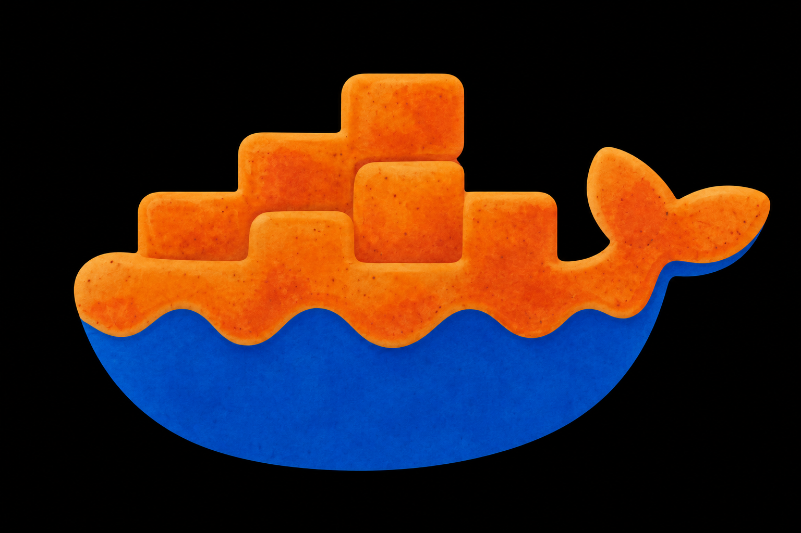

# dkglaze




[](go.mod)
[](LICENSE)

> **glaze** *(n.)* — a thin layer applied on top to finish, protect, or personalize what's beneath.

Run a container with your dotfiles, user account, tools, and SSH keys already layered in — reproducibly, on any base image, with simple run or build commands:

```sh
dkglaze build ubuntu:26.04
dkglaze run ubuntu:26.04
```

`dkglaze` takes a plain base image and layers your personal customizations on top of it, defined once in a config file as **features** — each contributing a Dockerfile template, runtime args/mounts, or both — and **profiles** (ordered combinations of features). Switch between setups with a single flag. Useful if you always work inside containers and want the same customizations on top of whatever base image a project uses — or if you're keeping coding-agent sandboxes consistent across projects with different languages and toolchains. Individual repos can also check in their own project-local config to layer in repo-specific tweaks on top of your global setup.

## Installation

```sh
go install github.com/future-cyborg/dkglaze/cmd/dkglaze@latest
```

Or grab a prebuilt binary (linux/darwin, amd64/arm64) from the [Releases page](https://github.com/future-cyborg/dkglaze/releases):

```sh
tar -xzf dkglaze_<version>_<os>_<arch>.tar.gz
mv dkglaze ~/.local/bin/   # anywhere on your PATH
```


### Requirements to run dkglaze

- A `docker` CLI on `PATH` and a reachable Docker daemon (`DOCKER_HOST` is honored). `build` shells out to `docker build`; `run` replaces the `dkglaze` process with `docker run` (so signals and the exit code pass straight through).
- `bash` and `sh` on the host. Shell-expanded config values run through `bash -c`, and dynamic `cmd:` values run through `sh -c`.

## Getting Started

```sh
dkglaze config init          # create ~/.config/dkglaze/config.yml with a blank starter config
```

`config init` can't guess what you want layered on — it creates a blank starter config with an empty `base` feature (no templates, no run args/mounts). Edit it (`dkglaze config edit`) to add what you actually want: build templates if you want dkglaze to build an image for you (see [Dockerfile templates](docs/CONFIGURATION.md#dockerfile-templates) for the format), run args/mounts if you just want runtime customization on top of an existing image, or both — see [Features](docs/CONFIGURATION.md#features) for the full schema. Then:

```sh
dkglaze build ubuntu:26.04   # build the user layer
dkglaze run ubuntu:26.04     # run it
```

See [examples/](examples/) for real config files, and [docs/CONFIGURATION.md](docs/CONFIGURATION.md) for the full config reference (features, profiles, project-local config, security model). Tab completion for commands, profiles, and features is also available — see [Shell Completion](#shell-completion).

## Usage

```
dkglaze <command> [flags]
```

| Command | Description |
|---|---|
| `build <image> [-- build-args...]` | Build the user layer on top of `<image>` (`--pull` to pull the latest base image first, `-n` for a dry run) |
| `run <image> [-- args...]` | Run the user-layer image, building it first if needed (`-n` for a dry run) |
| `clean [-n]` | Remove all images created by dkglaze (`-n` for dry run) |
| `list` | List all images created by dkglaze |
| `config` | Manage configuration (see below) |
| `completion <bash\|zsh>` | Print shell completion script to stdout |

### Build and run mechanics

- Extra args passed after `--` to `dkglaze build` are appended to **every** `docker build` invocation in the template chain:

  ```sh
  dkglaze build ubuntu:26.04 -- --no-cache --build-arg FOO=bar
  ```

- `run.mounts` are expanded (`~` and `$VAR`) and passed as `--volume` flags **before** any CLI args passed after `--` to `dkglaze run`, so one-off flags can extend or override what's in config:

  ```sh
  dkglaze run ubuntu:26.04 -- -e DEBUG=1
  # docker run <run.args> --volume <run.mounts...> -e DEBUG=1 <image>
  ```

- `-n` prints the resolved command(s) instead of running them, without side effects. On `build`, paths are shown as placeholders (e.g. `<base.dockerfile>`, `<context>`) rather than their resolved values; on `run` the printed command is exact. `-n` does not skip the `--trust` check for untrusted project-local config — see [docs/CONFIGURATION.md](docs/CONFIGURATION.md#security-model).

- `run`'s "building it first if needed" check is a plain image-tag existence check, not a content check: if an image already exists under the resolved tag, `run` uses it as-is, even if you've since edited templates, build args, or the config since it was built. Re-run `dkglaze build` (or `dkglaze clean` first) to pick up changes.

### `dkglaze config` subcommands

| Subcommand | Description |
|---|---|
| `config init` | Create the config directory and default `config.yml` |
| `config list profiles` | List all profiles and their own `features:` list (not expanded via `extends`) |
| `config list features` | List all features with a count of what each contributes |
| `config set default <profile>` | Change `defaults.profile` in the config file |
| `config validate` | Validate the config file against its schema (doesn't check feature/profile references or `extends` cycles — use `config show --resolved` for that) |
| `config show` | Print the raw config YAML, or `--resolved` to fully resolve and print every profile |
| `config edit` | Open the config file in `$EDITOR` |
| `config path` | Print the config file path |

**Global flags:** `--verbose` — shows full error stack traces with file and line numbers. Without `--verbose`, only the outermost error message is shown. `--version`/`-v` — print the version and exit.

**Profile flag:** `--profile <name>` (or `-p <name>`) on `build` and `run` — overrides `defaults.profile`.

**Feature flag:** `--feature <name>` (or `-f <name>`, repeatable) on `run` only — adds a named feature's `run.args`/`run.mounts` to this invocation, without declaring a whole new profile. See [project-local config](docs/CONFIGURATION.md#project-local-configuration) for the full semantics — most relevant there, since that's where composing ad hoc features matters most.

### Examples

```sh
dkglaze config init
dkglaze build ubuntu:26.04
dkglaze run ubuntu:26.04

# Use a non-default profile
dkglaze build --profile gpu-dev ubuntu:26.04
dkglaze run -p gpu-dev ubuntu:26.04

dkglaze clean -n   # preview what would be removed
dkglaze clean      # remove all dkglaze-managed images

# Pull the latest base image before rebuilding
dkglaze build --pull ubuntu:26.04
```

More, including project-local config and `-f`/`--feature` usage, in [examples/](examples/).

## Shell Completion

```sh
dkglaze completion bash   # prints a bash completion script to stdout
dkglaze completion zsh    # prints a zsh completion script to stdout (must be saved as `_dkglaze` for compinit to pick it up)
```

Wire the output into your shell however you normally install completions (sourced directly, or dropped into whatever completion directory your setup already uses). Tab completion covers subcommands, local Docker images, and profile/feature names (global and [project-local](docs/CONFIGURATION.md#project-local-configuration)).

Prebuilt release archives already include these scripts (`completions/dkglaze.bash`, `completions/dkglaze.zsh`) alongside the binary, if you'd rather not generate them yourself.

## Contributing

Building from source, running lint/tests, or contributing a change? See [docs/CONTRIBUTING.md](docs/CONTRIBUTING.md).

## License

dkglaze is released under the [MIT License](LICENSE).
